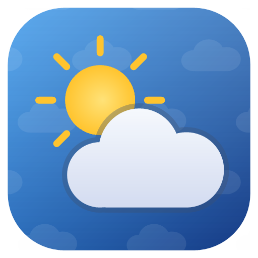
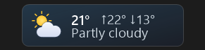
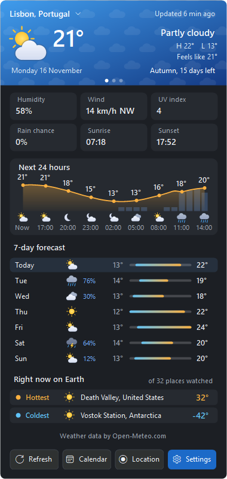
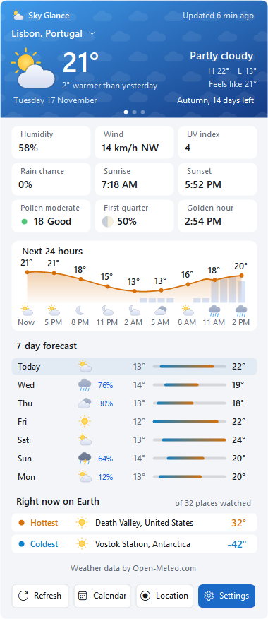
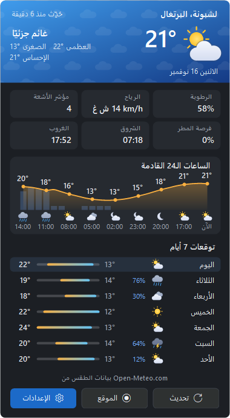
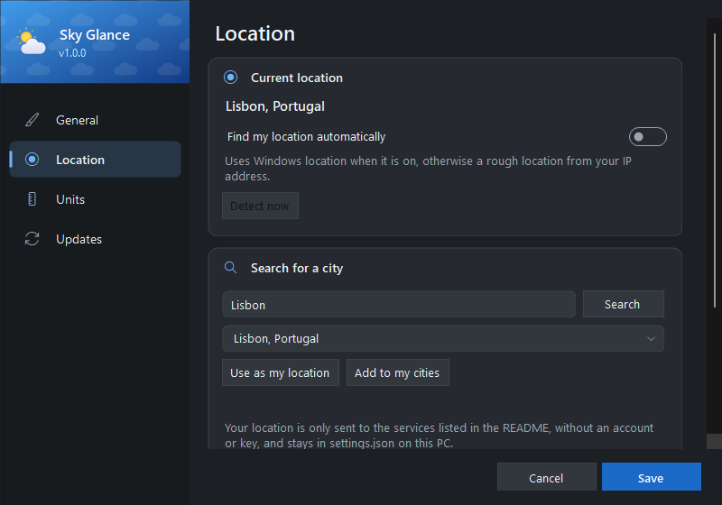
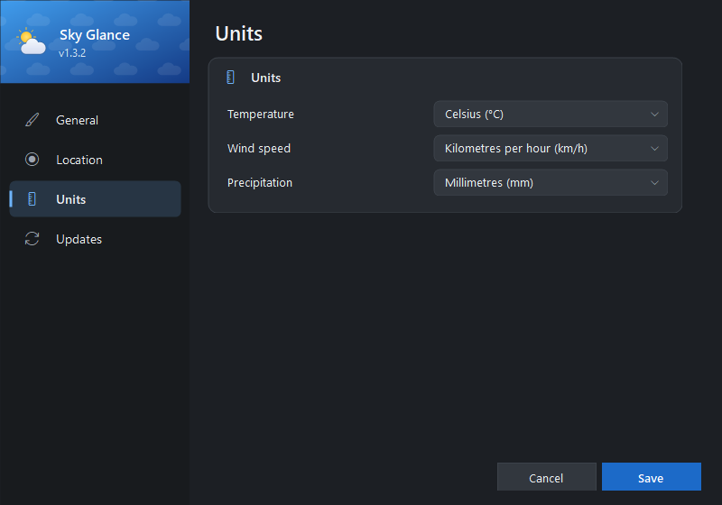
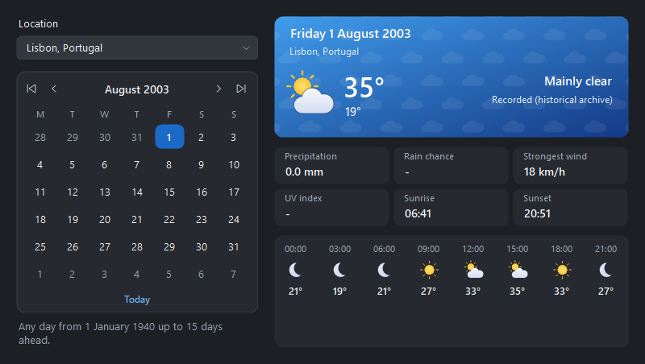
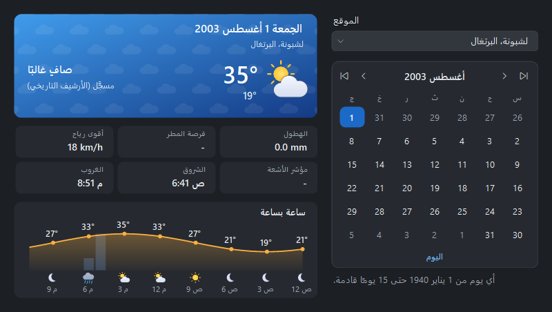

<div align="center">



# Sky Glance

**Live weather and the week's forecast, right in your Windows taskbar.**

A small native widget that sits in the taskbar and shows the temperature and the sky right now.
Click it for the next 24 hours and the next 7 days. Finds your location by itself or uses any city you pick,
with Celsius or Fahrenheit and five wind units. English and Arabic. No account, no API key.

[](https://github.com/medovanx/sky-glance/releases/latest)
[](https://github.com/medovanx/sky-glance/actions/workflows/ci.yml)
[](https://github.com/medovanx/sky-glance/releases)
[](LICENSE)


[**Download**](https://github.com/medovanx/sky-glance/releases/latest) | [Features](#features) | [Screenshots](#screenshots) | [Privacy](#privacy) | [Build](#build-from-source) | [العربية](#بالعربية)



</div>

---

## Features

- **Lives in the taskbar.** A weather picture, the temperature, today's high and low and the condition, embedded next to the notification area or at the left end. It takes the nearest free spot on either side, so it never covers other taskbar tools such as Data Tide, Salaty Reminder or TrafficMonitor, hides with the taskbar in fullscreen apps and comes back after Explorer restarts.
- **No tray icon.** Everything lives in the widget: right-click it for every command, and run the exe again to open the forecast. Update messages arrive as Windows notifications.
- **Forecast flyout.** Click the widget for the sky right now (with "feels like", today's high and low), humidity, wind and direction, UV index, rain chance, sunrise and sunset, a 24-hour temperature chart with rain chances, and a 7-day forecast with each day's range.
- **Your location, automatically.** Uses Windows location when it's on, otherwise a rough location from your IP address, and checks again every few hours so a laptop follows you. Or search for any city in the world and keep it.
- **Several cities.** Save as many cities as you like and switch between them by clicking the place name in the flyout, with the arrow keys, from the right-click menu, or by scrolling over the widget. Each city keeps its own cached forecast.
- **Weather on any date.** A calendar window shows any day from 1 January 1940 up to 15 days ahead for any of your cities: high and low, precipitation, wind, sunrise and sunset, and the day in three-hour steps. Click a day in the 7-day forecast to open it there.
- **Season.** The flyout shows the season at the place shown (it flips south of the equator) and how many days are left in it.
- **Hottest and coldest right now.** The flyout shows the hottest and coldest of 32 places around the world that usually hold the records, from Death Valley and Kuwait to Vostok Station and Oymyakon.
- **The time where the weather is.** A city in another time zone shows its own clock and its own "now".
- **Units.** Celsius or Fahrenheit; km/h, m/s, mph, knots or Beaufort; millimetres or inches. Switch the temperature unit straight from the right-click menu.
- **Works offline.** The last forecast is kept on disk and shown until the next one arrives; refreshes retry with a growing delay.
- **English and Arabic.** Full right-to-left layout in Arabic. Light and dark theme follow Windows.
- **Auto-updates.** Checks GitHub Releases, verifies the download's SHA-256 and updates itself in place.
- **Light and native.** One small Windows app, no Electron, no ads, no account.

Weather alerts are not included: Open-Meteo, the free keyless service Sky Glance uses, does not publish them.

## Screenshots

<table>
  <tr>
    <td align="center"><br><sub>Forecast flyout</sub></td>
    <td align="center"><br><sub>Light theme</sub></td>
    <td align="center"><br><sub>Arabic, right to left</sub></td>
  </tr>
</table>

<table>
  <tr>
    <td align="center"><br><sub>Automatic location or any city</sub></td>
    <td align="center"><br><sub>Units</sub></td>
  </tr>
  <tr>
    <td align="center"><br><sub>Weather on any date since 1940</sub></td>
    <td align="center"><br><sub>Calendar in Arabic</sub></td>
  </tr>
</table>

All screenshots use a made-up forecast for a demo city.

## Install

1. Download **`SkyGlance.exe`** from the [latest release](https://github.com/medovanx/sky-glance/releases/latest).
2. Put it somewhere permanent, for example `%LOCALAPPDATA%\Programs\Sky Glance\`, and run it.
3. Right-click the widget and turn on **Start with Windows**.

The exe is self-contained, so you don't need to install .NET. Windows SmartScreen may warn on first run because the exe isn't code-signed yet: choose **More info**, then **Run anyway**.

## Privacy

Sky Glance has no account, analytics or tracking. It only goes online for these services, all used without an API key:

| Service | When | What it sends |
| --- | --- | --- |
| [Open-Meteo Forecast](https://open-meteo.com/en/docs) | Every refresh (every 15 minutes by default), and for recent or coming dates in the calendar | The coordinates of the city shown or picked |
| [Open-Meteo Forecast](https://open-meteo.com/en/docs) | Every hour, for "hottest and coldest right now" (can be turned off) | The fixed coordinates of 32 watched places, nothing about you |
| [Open-Meteo Historical Weather](https://open-meteo.com/en/docs/historical-weather-api) | When you open a date more than 90 days ago | The coordinates of the city you picked and the date |
| [Open-Meteo Geocoding](https://open-meteo.com/en/docs/geocoding-api) | When you search for a city | The search text |
| [BigDataCloud](https://www.bigdatacloud.com/) | Auto location, to name the place Windows found | Your coordinates |
| [ipwho.is](https://ipwho.is/) | Auto location, only if Windows location is off or fails | Your IP address (implicitly) |
| [GitHub API](https://docs.github.com/rest/releases) | Update checks | Nothing besides the request |

Your settings, your cities and their last forecasts stay in `%APPDATA%\SkyGlance`. Choose a city instead of automatic location to stop the BigDataCloud and ipwho.is requests.

## How it works

- **The widget** is a per-pixel-alpha child window inside `Shell_TrayWnd`. On either side of the taskbar it takes the nearest spot that overlaps no other app's window there, so several such widgets settle side by side instead of pushing each other along. Its width depends only on the scale and settings, never on the weather, so it doesn't jitter. It recreates itself when Explorer restarts (`TaskbarCreated`) and finds the real tray edge through UI Automation when Windows reports it wrongly after boot.
- **The forecast** comes from one Open-Meteo request in metric units with `timezone=auto`. Unit changes are converted on your PC, so they need no new request, and "now" is worked out from the location's UTC offset rather than your PC's clock.
- **Updates** come from GitHub Releases tagged `vMAJOR.MINOR.PATCH`. The new exe is downloaded next to the running one and checked against the SHA-256 digest GitHub publishes. The running exe is then renamed to `.old`, the new one takes its place and restarts.

## Project structure

```text
sky-glance/
├── src/
│   ├── SkyGlance.Core/           Logic with no Windows or UI dependencies
│   │   ├── Places/               Saved cities and switching between them
│   │   ├── Seasons/              Meteorological seasons by hemisphere
│   │   ├── Units/                Temperature, wind and precipitation units
│   │   ├── Weather/              Open-Meteo requests and parsers, weather codes, forecast and day models
│   │   └── World/                Hottest and coldest of the watched places
│   └── SkyGlance/                The Windows app
│       ├── Assets/               Icon
│       ├── Configuration/        Settings and start-with-Windows
│       ├── DevTools/             --shots, --render-icon and demo data
│       ├── Interop/              Win32, DWM and theme calls
│       ├── Localization/         English and Arabic text and dates
│       ├── Services/             Weather, location, forecast cache, updater, log
│       └── UI/
│           ├── Calendar/         The "weather on a date" window
│           ├── Controls/         Themed toggle, dropdown, number box, buttons, day picker
│           ├── Flyout/           The forecast popup
│           ├── Settings/         The settings window
│           ├── Styling/          Theme colours and the weather drawings
│           └── Taskbar/          The widget inside the taskbar
├── tests/
│   └── SkyGlance.Core.Tests/     xUnit tests, with a real Open-Meteo answer as a fixture
├── docs/                         README images
├── Directory.Build.props         Version and settings shared by every project
├── global.json                   Pinned .NET SDK
└── SkyGlance.slnx
```

## Build from source

Requirements: Windows 10 or 11 and the [.NET 10 SDK](https://dotnet.microsoft.com/download).

```bash
git clone https://github.com/medovanx/sky-glance.git
cd sky-glance
dotnet build
dotnet test
dotnet run --project src/SkyGlance -c Release
```

Build the single-file release exe:

```bash
dotnet publish src/SkyGlance/SkyGlance.csproj -c Release -r win-x64 --self-contained -p:PublishSingleFile=true -p:IncludeNativeLibrariesForSelfExtract=true -p:EnableCompressionInSingleFile=true -o publish
```

Developer switches:

| Switch | Purpose |
| --- | --- |
| `--shots DIR` | Render the widget, flyout, settings pages and every weather picture from demo data, offline |
| `--render-icon DIR` | Regenerate `app.ico` and a 512 px PNG |

## Releasing

Versions follow [Semantic Versioning](https://semver.org/). Bump `<Version>` in `Directory.Build.props`, add the changes to [CHANGELOG.md](CHANGELOG.md), then tag and push:

```bash
git tag v1.1.0
git push origin v1.1.0
```

The [release workflow](.github/workflows/release.yml) runs the tests, builds the exe and publishes a GitHub Release, which running copies pick up automatically.

## Credits

- Weather data by [Open-Meteo.com](https://open-meteo.com/), licensed under [CC BY 4.0](https://creativecommons.org/licenses/by/4.0/). The free API is for non-commercial use.
- Place search by the Open-Meteo Geocoding API, based on [GeoNames](https://www.geonames.org/).
- Icons: Segoe Fluent Icons by Microsoft, built into Windows. The weather pictures are drawn in code.

## License

[MIT](LICENSE).

---

<div dir="rtl">

## بالعربية

**سكاي جلانس** أداة صغيرة تظهر في شريط المهام، تعرض درجة الحرارة وحالة السماء الآن، وبنقرة واحدة تعرض توقعات الساعات الـ24 القادمة والأيام السبعة القادمة.

- تحديد موقعك تلقائيًا عبر خدمة الموقع في ويندوز أو عنوان IP، أو اختيار أي مدينة في العالم
- الرطوبة والرياح واتجاهها ومؤشر الأشعة وفرصة المطر ووقت الشروق والغروب
- درجة مئوية أو فهرنهايت، وخمس وحدات لسرعة الرياح
- عدة مدن مع التبديل بينها، والطقس في أي يوم منذ 1940
- الفصل الحالي، وأشد الأماكن حرًا وبردًا على الأرض الآن
- لا تغطي الأدوات الأخرى في شريط المهام مثل داتا تايد وصلاتي
- واجهة عربية كاملة من اليمين إلى اليسار، ووضع داكن وفاتح يتبع ويندوز
- بلا حساب ولا مفتاح API، وتحديث تلقائي آمن من GitHub

</div>
